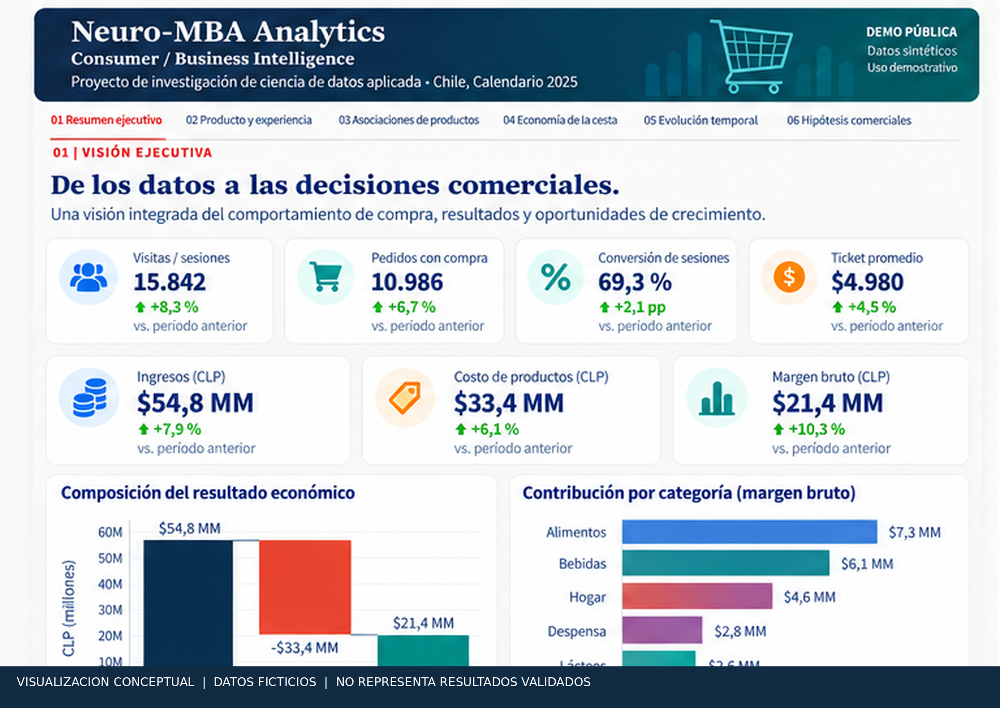
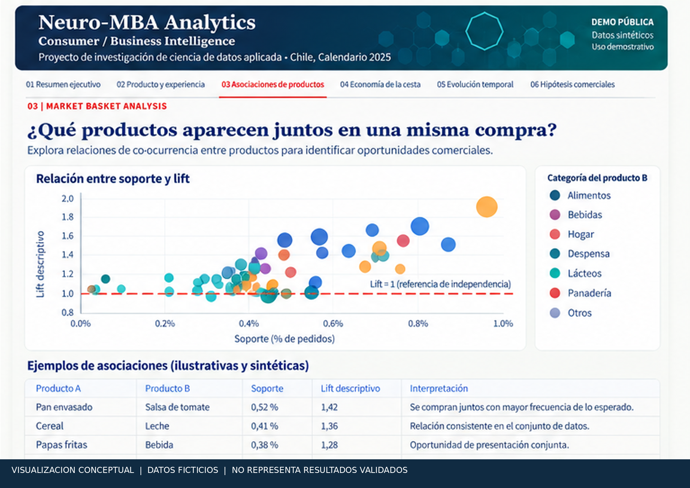
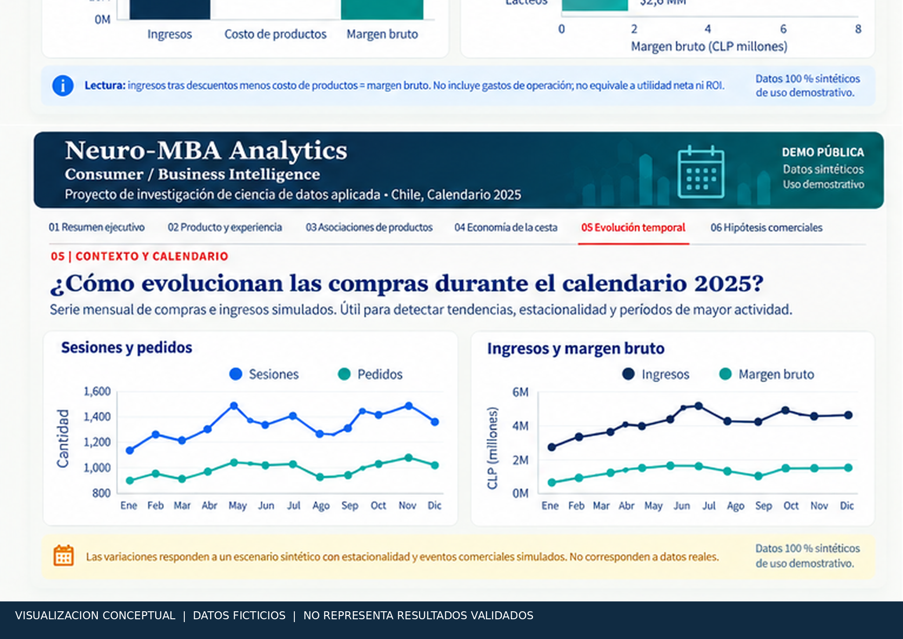
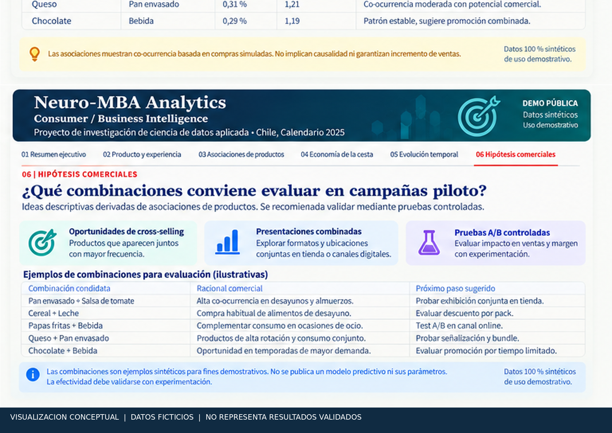

# Neuro-MBA Analytics

## Consumer / Business Intelligence

**De los datos a las decisiones comerciales.**

Neuro-MBA Analytics es un proyecto de investigación de ciencia de datos aplicada orientado a explorar patrones de comportamiento de compra, asociaciones entre productos, tendencias temporales e hipótesis para apoyar la evaluación de decisiones comerciales.

**Chile · Calendario 2025**

> **Alcance:** las siguientes imágenes son visualizaciones conceptuales elaboradas con datos ficticios para mostrar el diseño propuesto. No constituyen capturas certificadas de la aplicación ni resultados empíricos o predictivos validados.

### 01. Visión ejecutiva

Una lectura integrada de indicadores comerciales permite comunicar resultados de un escenario demostrativo. Los valores de la ilustración no describen ventas reales.

### 03. Asociaciones de productos | Market Basket Analysis

Mediante técnicas de Market Basket Analysis se exploran relaciones estadísticas entre productos adquiridos dentro de una misma transacción. Soporte, confianza y *lift* describen asociaciones; no establecen causalidad ni garantizan resultados de ventas.

### 05. Evolución temporal

Las visualizaciones ilustran tendencias comerciales a lo largo de un calendario sintético 2025. No se infiere estacionalidad real ni comportamiento predictivo.

### 06. Hipótesis comerciales | Cross-Selling

Los patrones de asociación pueden orientar hipótesis de venta cruzada, promociones combinadas y experiencias de compra. La efectividad requiere validación experimental y evaluación económica.

### Alcance de la demostración y confidencialidad

Las visualizaciones corresponden a escenarios sintéticos preparados para divulgación. No representan mediciones reales ni resultados comerciales validados.

La implementación especializada, las parametrizaciones de investigación, los datos experimentales detallados y determinados componentes de ingeniería permanecen reservados.

Las organizaciones interesadas pueden solicitar demostraciones técnicas ampliadas, sujetas a las condiciones de acceso y confidencialidad correspondientes.

**Tecnologías del prototipo:** Python · Streamlit · pandas · NumPy · Plotly · pytest.

*Proyecto de investigación de ciencia de datos aplicada · Chile, Calendario 2025.*

### Licenciamiento

La publicación de imágenes y documentación no concede licencia sobre código ni metodologías reservadas. All rights reserved unless expressly stated otherwise.
